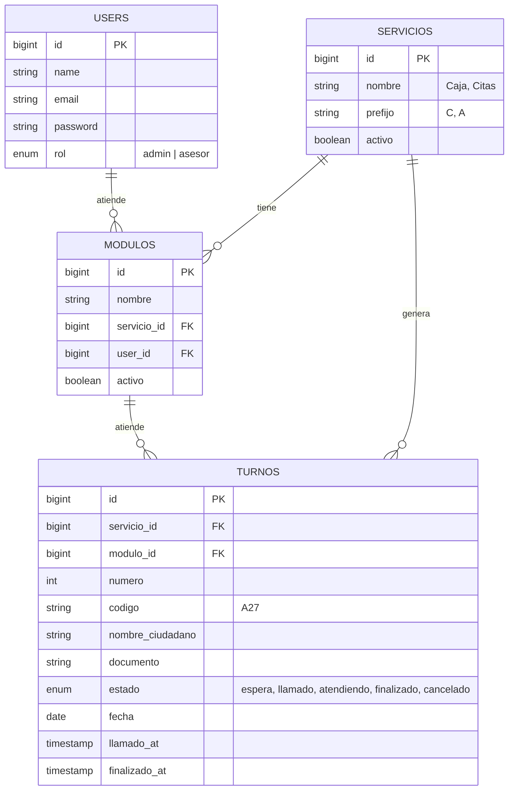

# Diagrama entidad-relación (bd_TurnosVirtuales)

Pega este bloque en https://mermaid.live para obtener la imagen y colocarla en el informe.

# Actores y casos de uso

| Actor | Casos de uso |
|---|---|
| Ciudadano | Seleccionar servicio, tomar turno, imprimir ticket, ver su turno en pantalla, escuchar el llamado |
| Asesor | Iniciar sesión, elegir módulo, llamar siguiente, volver a llamar, iniciar atención, finalizar, marcar "no se presentó" |
| Administrador | Iniciar sesión, consultar estadísticas por rango de fechas, exportar reporte CSV |
| Sistema | Numerar turnos por día, difundir eventos por WebSocket (Reverb), anunciar por voz en la pantalla pública |

# Estados de un turno

espera -> llamado -> atendiendo -> finalizado
espera -> llamado -> cancelado (el ciudadano no se presentó)
